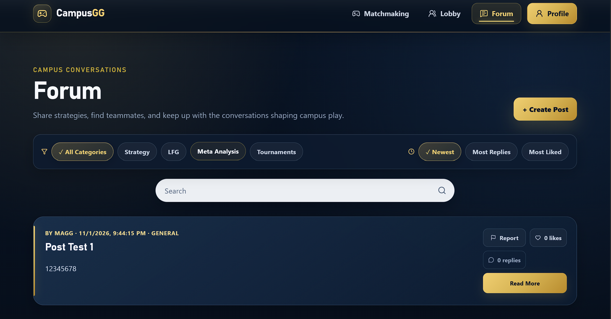
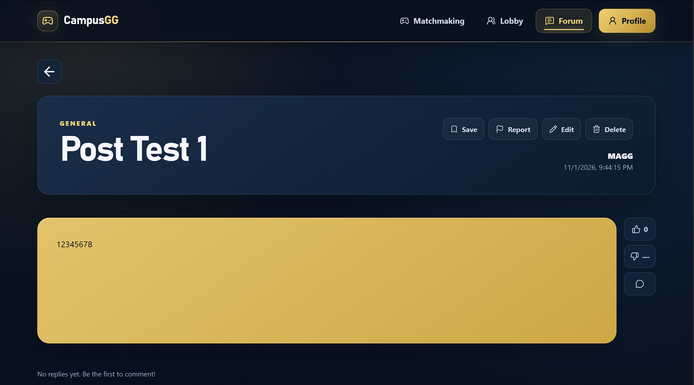

### Manual Test Report #5

**Test Case ID:** FRS-001

**Test Title:** Verify Campus Forum Posts Are Displayed

**Related Requirement(s):** FR-008

**Tester Name:** Jingwen Huang

**Date Executed:** 2026-11-01

**Environment:** Localhost, Windows 11, Google Chrome, CampusGG

### Preconditions

* CampusGG is running locally.
* The Forum page is accessible.
* Existing forum posts are available.

### Test Steps

| Step | Action | Expected Result | Actual Result | Pass/Fail |
| --- | --- | --- | --- | --- |
| **1** | Open the CampusGG Forum page. | The Forum page loads successfully. | Forum page loaded successfully. | **Pass** |
| **2** | Check the existing forum posts. | Existing posts are displayed. | Posts displayed correctly. | **Pass** |
| **3** | Check the information shown on posts. | Post titles and other information are displayed correctly. | Post information displayed correctly. | **Pass** |
| **4** | Click a forum post. | The Post Detail page opens. | Post Detail page opened successfully. | **Pass** |
| **5** | Return to the Forum page and refresh. | Posts remain visible after refreshing. | Posts remained visible. | **Pass** |

### Overall Result

**PASS**

### Evidence & Notes

* **Screenshots/Logs:**
  * Forum Page: 
  * Post Detail Page: 