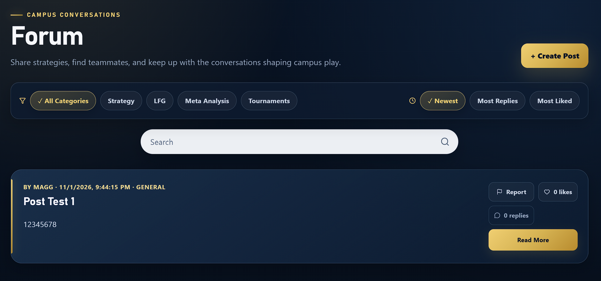

### Manual Test Report #6

**Test Case ID:** FRS-002
**Test Title:** Verify a User Can Create a Forum Post
**Related Requirement(s):** FR-008
**Tester Name:** Jingwen Huang
**Date Executed:** 2026-11-01
**Environment:** Localhost, Windows 11, Google Chrome, CampusGG

### Preconditions

* CampusGG is running locally.
* The user is logged in and can access the Forum page.

### Test Steps

| Step | Action | Expected Result | Actual Result | Pass/Fail |
| --- | --- | --- | --- | --- |
| **1** | Log in and open Forum. | Forum page loads. | Forum loaded successfully. | **Pass** |
| **2** | Click Create Post. | Post creation form opens. | Form opened successfully. | **Pass** |
| **3** | Enter a valid title and content. | Form accepts the input. | Input accepted. | **Pass** |
| **4** | Click Publish. | Post is created successfully. | Post created successfully. | **Pass** |
| **5** | Return to Forum. | New post appears in the list. | New post displayed. | **Pass** |
| **6** | Refresh the page. | New post remains visible. | Post remained visible. | **Pass** |

### Overall Result

**PASS**

### Evidence & Notes

* **Screenshots/Logs:**
  * Forum After Refresh: 

* **Defects Raised:** None observed.