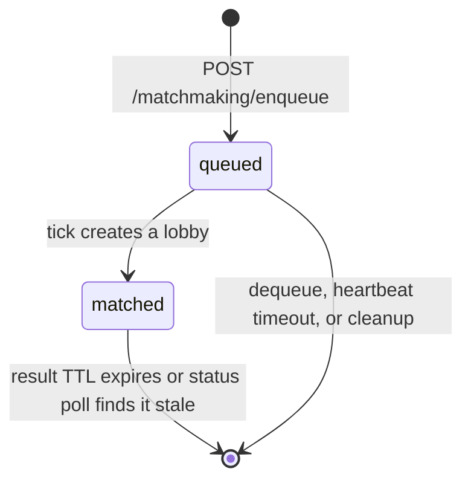

# Reference — CampusGG

## 1. System Structure
### 1.1 Repository layout
| Path | Role |
|---|---|
| `campusgg-frontend/` | Active React 19 + Vite SPA. Pages: SignIn, SignUp, VerifyEmail, Home, Lobby, LobbyDetail, CreateLobby, Matchmaking, Chat, Forum, CreatePost, PostDetail, Profile. |
| `campusgg-backend/` | Active NestJS 11 + TypeScript API; TypeORM + PostgreSQL. |
| `frontend/` | Legacy static HTML/CSS/JS prototype; not the active client. |
| `doc/`, `Testing/` | Design and verification documents; manual test plans, defect reports, RCA log. |
| `mock-data/` | Matchmaking fixture data (`mock_players.json`). |
| `.github/workflows/ci.yml` | CI: lint → migrations → unit tests → integration tests → build. |

### 1.2 Runtime components
| Component | Technology | Address | Notes |
|---|---|---|---|
| SPA | React 19, Vite 8, React Router 7 | `localhost:5173` | `npm run dev` |
| API | NestJS 11, Express | `localhost:3000` | Port hard-coded in `main.ts`; no global route prefix |
| Database | PostgreSQL 16 | `localhost:5432` | Docker service `postgres` |
| Cache | Redis | `localhost:6379` | Optional, disabled by default; no feature uses it |
| Email | Resend API | — | Console fallback when `RESEND_API_KEY` is absent |
| Matchmaker | In-process `setInterval` | — | One scheduler per API process; ticks serialized by advisory lock |

### 1.3 Backend modules
| Module | Key files | Responsibility |
|---|---|---|
| `AuthModule` | `auth.controller.ts`, `login.controller.ts`, `auth.service.ts`, `login.service.ts`, `mail.service.ts`, `jwt-auth.guard.ts` | Registration, OTP verification, login, JWT issuance, email |
| `UsersModule` | `users.controller.ts`, `users.service.ts`, `user.entity.ts` | Raw user CRUD and profile lookup |
| `LobbiesModule` | `lobbies.controller.ts`, `lobbies.service.ts`, `lobby.entity.ts`, `lobby-member.entity.ts` | Lobby CRUD, membership, capacity, host rules |
| `MatchmakingModule` | `matchmaking.controller.ts`, `matchmaking.service.ts`, `matchmaking.repository.ts`, `engine/*` | Queue, scoring, tick transaction, lobby handoff |
| `ForumModule` | `forum.controller.ts`, `forum-comments.controller.ts`, `forum-like-status.controller.ts`, entities | Posts, comments, likes, author permissions |
| `RedisModule` | `redis.module.ts`, `redis.service.ts` | Optional Redis client; not injected by any feature |

### 1.4 Implementation notes
- There is no global route prefix; base paths are `/api/auth`, `/users`, `/lobbies`, `/matchmaking`, `/forum/posts`, `/database`. A global `ValidationPipe({ whitelist: true, transform: true })` strips unknown fields; CORS is open to all origins.
- `synchronize: false`; migrations are the schema authority (`npm run migration:run`).
- `DatabaseController` exposes `GET /database/test`. `events/events.gateway.ts` is not registered in `AppModule`, so no WebSocket feature is live; `GET /lobbies` returns hard-coded mock data while `GET /lobbies/db` is the DB-backed list.

## 2. Key APIs / Interfaces
Auth and Lobbies are specified here; Matchmaking and Forum are in §5 and §6. All remaining routes are indexed in §2.4.

### 2.1 Conventions
- Base URL `http://localhost:3000`; JSON bodies; UUID v4 ids; ISO-8601 timestamps. Protected routes require `Authorization: Bearer <access_token>`; JWT payload `{ sub: "<user uuid>" }`, 1-hour expiry, secret `JWT_SECRET`. There is no refresh-token, logout, or revocation endpoint.
- Errors use Nest's default shape `{ "statusCode": 400, "message": "...", "error": "Bad Request" }`. Unknown body fields are stripped, invalid input returns `400`, and POST defaults to `201` unless `@HttpCode(HttpStatus.OK)` sets `200`.

### 2.2 Auth API
| Method and path | Auth | Request | Success | Errors |
|---|---|---|---|---|
| `POST /api/auth/register` | none | `email` (valid `.edu`), `username` (3–50, unique case-insensitive), `displayName?` (≤100, defaults to `username`), `password?` (8–100) | `201` safe user, omitting `password` and `verificationToken` | `400` invalid `.edu` or validation; `409` duplicate email or username |
| `POST /api/auth/verify` | none | `email`, `code` | `200` `{ statusCode: 200, message: "Email verified successfully." }` | `400` invalid or expired code, user not found |
| `POST /api/auth/resend-verification` | none | `email` | `200` `{ message }` | `400` invalid `.edu`; `400` already verified |
| `POST /api/auth/login` | none | `email`, `password` | `200` `{ access_token }` | `401` invalid credentials; `403` email not verified |

- Email is lowercased and trimmed before every lookup; `.edu` is enforced by the strict regex in `auth.service.ts`.
- OTP is 6 digits from `crypto.randomInt(100000, 999999)`, valid 10 minutes, stored in `verification_token` (`select: false`) with `token_expires_at`. Mail failure does not fail registration; without `RESEND_API_KEY` the code is logged to the console. No rate limiting or OTP lockout exists.

### 2.3 Lobby API
| Method and path | Auth | Request | Success | Errors |
|---|---|---|---|---|
| `GET /lobbies` | none | — | `200` 4 hard-coded mock objects (`id`, `name`, `host`, `game`, `level`, `details`) | — |
| `GET /lobbies/db` | none | `game?` (≤50), `skillLevel?` (≤30) | `200` `Lobby[]`, `createdAt DESC`, no pagination | `400` invalid query |
| `GET /lobbies/:id` | none | UUID | `200` `Lobby` | `400` bad UUID; `404` not found |
| `POST /lobbies` | JWT | `lobbyName` (≤60), `subtitle?` (≤160), `details` (≤500), `tags?`, `game?` (≤50), `skillLevel?` (≤30), `participantLimit?` (≥1), `visibility?` (`public`/`private`/`friends`) | `201` `Lobby` with embedded host | `400` validation; `401`; `404` user not found |
| `POST /lobbies/:id/join` | JWT | — | `200` `{ message: "Successfully joined lobby" }` | `401`; `403` not public; `404` lobby or user; `409` already a member or full |
| `POST /lobbies/:id/leave` | JWT | — | `200` `{ message: "Successfully left lobby" }` | `401`; `403` host cannot leave; `404` lobby or membership |
| `GET /lobbies/:id/members` | JWT | — | `200` `[{ id, username, role }]` | `401`; `404` lobby |

- `POST /lobbies` creates the lobby and the host's `lobby_members` row (`role = 'host'`) in one transaction; `POST /lobbies/:id/join` allows public lobbies only, takes a pessimistic lobby lock, and counts the host toward capacity.
- Hosts cannot leave; there is no ownership transfer, close, update/delete, or "my lobbies" endpoint, and list/detail queries do not load the host relation, so the client filters locally.

### 2.4 Endpoint Index
| Area | Methods and paths | Auth | Detailed in |
|---|---|---|---|
| Auth | `POST /api/auth/register`<br>`POST /api/auth/verify`<br>`POST /api/auth/resend-verification`<br>`POST /api/auth/login` | none | §2.2 |
| Lobbies | 7 routes | mixed | §2.3 |
| Matchmaking | `POST /matchmaking/enqueue`<br>`GET /matchmaking/match-status`<br>`POST /matchmaking/process`<br>`POST /matchmaking/dequeue` | JWT | §5.6 |
| Forum | 13 routes under `/forum/posts` | mixed | §6.1 |
| Users / Database | `POST /users`<br>`GET /users`<br>`GET /users/:id`<br>`GET /database/test` | none | This section |

`GET /users/:id` hydrates the signed-in profile; `POST /users` is raw CRUD with no `.edu` validation or duplicate handling and is not used by the React client. `GET /database/test` returns `{ status, database, user, server_time }`.

## 3. Configuration
### 3.1 Backend environment variables
| Variable | Required | Default | Used by / notes |
|---|---|---|---|
| `DATABASE_URL` | **yes** | none | TypeORM connection string |
| `DATABASE_SSL`, `DATABASE_SSL_REJECT_UNAUTHORIZED`, `DATABASE_SSL_CA` | no | `false`, `true`, unset | Managed-PostgreSQL SSL; CA is a bundle path read by `database-options.ts` |
| `DATABASE_POOL_SIZE`, `DATABASE_CONNECTION_TIMEOUT_MS`, `DATABASE_IDLE_TIMEOUT_MS` | no | `10`, `10000`, `30000` | Pool maximum, connection timeout, idle timeout |
| `PORT` | no | `3000` | **Not read**; `main.ts` hard-codes `listen(3000)` |
| `NODE_ENV` | no | `development` | `production` disables `POST /matchmaking/process` |
| `APP_BASE_URL` | no | `http://localhost:3000` | Not read by runtime code; reserved for email links |
| `JWT_SECRET` | **yes** | none | Required by `AuthModule`; missing from `.env.example` |
| `MATCHMAKING_TICK_INTERVAL_MS`, `MATCHMAKING_HEARTBEAT_TIMEOUT_MS`, `MATCHMAKING_RESULT_TTL_MS`, `MATCHMAKING_BATCH_SIZE`, `MATCHMAKING_SEARCH_WINDOW` | no | `3000`, `120000`, `300000`, `1000`, `15` | Tick period; stale-queue timeout; matched-result retention; max rows per tick; candidate window (max 20) |
| `MAIL_FROM`, `RESEND_API_KEY` | no | `.env.example` sets `CampusGG <noreply@campusgg.edu>`; code fallback is `onboarding@resend.dev`; key unset | Resend sender and key. Production must use the verified domain `notifications.campusgg.net`, e.g. `CampusGG <noreply@notifications.campusgg.net>`; without the key, OTPs are logged to the console. `RESEND_API_KEY` is missing from `.env.example`. |
| `SMTP_HOST`, `SMTP_PORT`, `SMTP_USER`, `SMTP_PASS` | no | empty | Unused; `MailService` uses Resend, not SMTP |
| `REDIS_ENABLED`, `REDIS_HOST`, `REDIS_PORT`, `REDIS_TLS` | no | `false`, `localhost`, `6379`, `false` | Optional client, disabled by default and not injected by any feature; `REDIS_TLS` switches to `rediss://` |

### 3.2 Frontend environment variables
| Variable | Default | Used by |
|---|---|---|
| `VITE_API_URL` | `http://localhost:3000` | Every API call |
| `VITE_APP_VERSION` | `0.1.0` | `VersionLabel` |

### 3.3 Configuration notes
- The backend reads `campusgg-backend/.env`; the root `.env.example` is a stale duplicate. `JWT_SECRET` is required but absent from both templates.
- `MAIL_FROM` must use the verified Resend domain `notifications.campusgg.net`; the `.env.example` value `noreply@campusgg.edu` is not a verified sending domain.
- `PORT` is ignored, `SMTP_*` and `APP_BASE_URL` are unused, and `REDIS_*` is optional; `DATABASE_SSL_CA` and `REDIS_TLS` are read by code but absent from `.env.example`.

## 4. DB Schemas
Unless noted, every table has `id uuid` PK (`gen_random_uuid()`) and `created_at`/`updated_at` timestamps; `lobby_members` uses `joined_at` instead, and `matchmaking_entries` uses `timestamptz`. `synchronize: false`; run `npm run migration:run` (migrations `InitialSchema1761955200000`, `MatchmakingPersistence1761955300000`).

### 4.1 `users`
| Column | Type | Constraints |
|---|---|---|
| `email` | `varchar` | not null, unique `UQ_users_email` |
| `username` | `varchar(50)` | not null, unique `UQ_users_username` |
| `display_name` | `varchar(100)` | nullable |
| `edu_verified` | `boolean` | not null, default `false` |
| `verification_token` / `token_expires_at` | `varchar` / `timestamptz` | nullable; token indexed and `select: false`; OTP valid 10 minutes |
| `password` | `varchar` | nullable; bcrypt hash, `select: false` |

### 4.2 `lobbies`
| Column | Type | Constraints |
|---|---|---|
| `lobby_name` | `varchar(60)` | not null |
| `subtitle` | `varchar(160)` | nullable |
| `details` | `varchar(500)` | not null |
| `tags` | `text[]` | not null; service writes `[]` when omitted |
| `game` / `skill_level` | `varchar(50)` / `varchar(30)` | nullable |
| `participant_limit` | `integer` | nullable |
| `visibility` | `lobbies_visibility_enum` | not null, default `public`; `public`, `private`, `friends` |
| `host_id` | `uuid` | not null, FK `users(id)` `ON DELETE RESTRICT` |

### 4.3 `lobby_members`
| Column | Type | Constraints |
|---|---|---|
| `lobby_id` | `uuid` | not null, FK `lobbies(id)` `ON DELETE CASCADE` |
| `user_id` | `uuid` | not null, FK `users(id)` `ON DELETE CASCADE`; unique `UQ_lobby_members_lobby_user (lobby_id, user_id)` |
| `role` | `varchar(10)` | not null, default `member`; `host`, `member` |
| `joined_at` | `timestamp` | not null, default `now()` |

### 4.4 `matchmaking_entries`
Indexes: `(game, status, enqueued_at)`, `(status, heartbeat_at)`, `(status, match_expires_at)`.

| Column | Type | Constraints |
|---|---|---|
| `user_id` | `uuid` | not null, FK `users(id)` CASCADE; unique `UQ_matchmaking_entries_user` (one row per user) |
| `game` / `status` | `varchar(50)` / `varchar(20)` | not null; status default `queued`; `queued`, `matched` |
| `payload` | `jsonb` | not null; validated `PlayerMatchmakingInput` |
| `enqueued_at` / `heartbeat_at` | `timestamptz` | not null, default `now()` |
| `matched_at` / `match_expires_at` | `timestamptz` | nullable; expiry = `matched_at` + result TTL |
| `lobby_id` | `uuid` | nullable, FK `lobbies(id)` `ON DELETE SET NULL` |
| `group_id` / `score` | `varchar(60)` / `double precision` | nullable; `grp_<uuid>` and compatibility score |

### 4.5 `forum_posts`
| Column | Type | Constraints |
|---|---|---|
| `title` / `content` | `varchar(120)` / `text` | not null |
| `game` | `varchar(50)` | nullable |
| `author_id` | `uuid` | not null, FK `users(id)` `ON DELETE RESTRICT` |

### 4.6 `forum_comments`
| Column | Type | Constraints |
|---|---|---|
| `content` | `text` | not null |
| `post_id` / `author_id` | `uuid` | not null; FKs `forum_posts(id)` CASCADE and `users(id)` RESTRICT |

### 4.7 `forum_post_likes`
| Column | Type | Constraints |
|---|---|---|
| `post_id` | `uuid` | not null, FK `forum_posts(id)` `ON DELETE CASCADE` |
| `user_id` | `uuid` | not null, FK `users(id)` `ON DELETE CASCADE`; unique `UQ_forum_post_user_like (post_id, user_id)` |

Schema notes: `likeCount` is derived from `forum_post_likes`, not stored; deleting a post cascades its comments and likes. No `updated_at` trigger (TypeORM updates on save); `users.password` and `users.verification_token` are excluded from default selects.

## 5. Project-Specific Section 1 — Matchmaking Engine
### 5.1 Queue state machine


- One row per user (`UQ_matchmaking_entries_user` guards cross-instance enqueue); `queued` rows expire after `MATCHMAKING_HEARTBEAT_TIMEOUT_MS` (default 2 minutes) without a status poll.
- `matched` rows persist for `MATCHMAKING_RESULT_TTL_MS` (default 5 minutes) so a lost poll response is recoverable.

### 5.2 Tick transaction and concurrency
- In-process `setInterval` every `MATCHMAKING_TICK_INTERVAL_MS` (default 3 s); each tick takes `pg_try_advisory_xact_lock(hashtext('campusgg:matchmaking:tick:v1'))`, so a second instance skips.
- Order: cleanup expired rows → load up to `MATCHMAKING_BATCH_SIZE` queued rows → plan groups → create lobby and members → mark rows `matched`.
- The tick is one transaction; any failure rolls it back and players stay queued. A missing batch row raises `MatchmakingConcurrencyError` and aborts the tick.

### 5.3 Group formation
- Hard partition by `game`: **5** players for Competitive (`CS2`, `Valorant`, `League of Legends`, `Dota`, `OW2`, `Rocket League`), **2** for Casual (`It Takes Two`).
- Search the first `MATCHMAKING_SEARCH_WINDOW` players (default 15, max 20), score all combinations, accept the best group meeting the dynamic threshold (ties go to the longest waiter), and repeat until none remain.

### 5.4 Scoring model
```text
Competitive score = min(1.0,
  0.30 × skill + 0.30 × intensity + 0.40 × profile
  × role synergy multiplier)
```

| Dimension | Rule |
|---|---|
| Skill cohesion | Rating spread ≤ 500 → 1.0; ≥ 2000 → 0.2; linear between |
| Intensity alignment | Spread ≤ 0.2 → 1.0; ≥ 1.0 → 0.0; linear between |
| Profile affinity | `max(university frequency) / group size` + `0.1` per same-major pair; capped at 1.0 |
| Role synergy | 5 unique primary roles → 1.10; 4 → 1.05; ≤ 3 → 1.00 |
| Casual tier | 1.0 for any non-empty group |

### 5.5 Time-decay threshold
```text
threshold(t) = 0.30 + 0.55 × e^(-0.003367t)   for t ≤ 270 s
smoothstep blend to 0.30 at t = 300 s
```

| Queue time | 0 s | 60 s | 120 s | 180 s | 240 s | 270 s | 300 s |
|---|---|---|---|---|---|---|---|
| Threshold | 0.850 | 0.749 | 0.667 | 0.600 | 0.545 | 0.522 | 0.300 |

A group uses the maximum wait time among its members; no group below the 0.30 floor is accepted.

### 5.6 HTTP surface
| Method and path | Auth | Request | Success | Errors |
|---|---|---|---|---|
| `POST /matchmaking/enqueue` | JWT | `game`, `profile`, `stats`, `preferences`, `intensity` | `201` `{ ok: true }` | `400` invalid payload or roles; `401`; `409` already queued or pending match |
| `GET /matchmaking/match-status` | JWT | — | `200` `{ matched, queued, lobbyId?, game?, enqueuedAt? }` | `401` |
| `POST /matchmaking/process` | JWT | — | `201` `{ ok: true }` | `401`; `403` in production |
| `POST /matchmaking/dequeue` | JWT | — | `201` `{ ok: true, removed }` | `401` |

Enqueue accepts `game` (one of 7 titles), `profile.{universityDomain, major, activeSchedule}`, `stats.{game, rating 0–35000}`, `preferences.{primaryRole, secondaryRole, micEnabled}`, and `intensity` (0–1); roles are validated against the game's role list.

### 5.7 Guarantees and limitations
- No duplicate queue rows (unique `user_id`), no double-processing across instances (advisory lock), and no orphan lobby (queue transition and lobby creation commit together); stale entries are filtered before planning.
- Solo queue only: no party queue, rank/season reset, or cross-region matching. The scheduler is in-process, and the advisory lock serializes ticks across instances.

## 6. Project-Specific Section 2 — Forum
### 6.1 Endpoints
| Method and path | Auth | Request | Success |
|---|---|---|---|
| `GET /forum/posts` | none | `page?` (default 1), `limit?` (default 25, max 100) | `200` `{ posts, total, page, limit }`, newest first |
| `GET /forum/posts/:id` | none | UUID | `200` post + `likeCount` |
| `POST /forum/posts` | JWT + verified | `title` (3–120), `content` (1–10000), `game?` (≤50) | `201` created post |
| `PATCH /forum/posts/:id` | JWT + author | `title?`, `content?`, `game?` | `200` updated post |
| `DELETE /forum/posts/:id` | JWT + author | — | `200` `{ message: "Forum post deleted successfully" }` |
| `POST /forum/posts/:id/like` | JWT + verified | — | `201` `{ postId, likeCount }`, idempotent |
| `DELETE /forum/posts/:id/like` | JWT | — | `200` `{ postId, likeCount }` |
| `GET /forum/posts/:id/likes` | none | UUID | `200` `{ postId, likeCount }` |
| `GET /forum/posts/:postId/likes/me` | JWT | — | `200` `{ postId, liked }` |
| `GET /forum/posts/:postId/comments` | none | `page?` (default 1), `limit?` (default 20, max 50) | `200` `{ comments, total, page, limit }`, oldest first |
| `POST /forum/posts/:postId/comments` | JWT + verified | `content` (1–2000) | `201` created comment |
| `PATCH /forum/posts/:postId/comments/:commentId` | JWT + author | `content` (1–2000) | `200` updated comment |
| `DELETE /forum/posts/:postId/comments/:commentId` | JWT + author | — | `200` `{ message: "Forum comment deleted successfully" }` |

### 6.2 Rules and behavior
- Creating a post, comment, or like requires `edu_verified = true`; editing or deleting requires the caller to be the author (`403` otherwise, `404` if missing).
- Posts are paginated newest-first; comments are oldest-first with an `id` tiebreaker. `limit` is clamped (posts ≤100, comments ≤50) and `page` is floored at 1.
- Likes are idempotent (`orIgnore()`, `INSERT ... ON CONFLICT DO NOTHING`); responses embed a minimal author `{ id, username, displayName }`.
- No moderation role, soft delete, search, edit history, attachments, or rate limiting.
